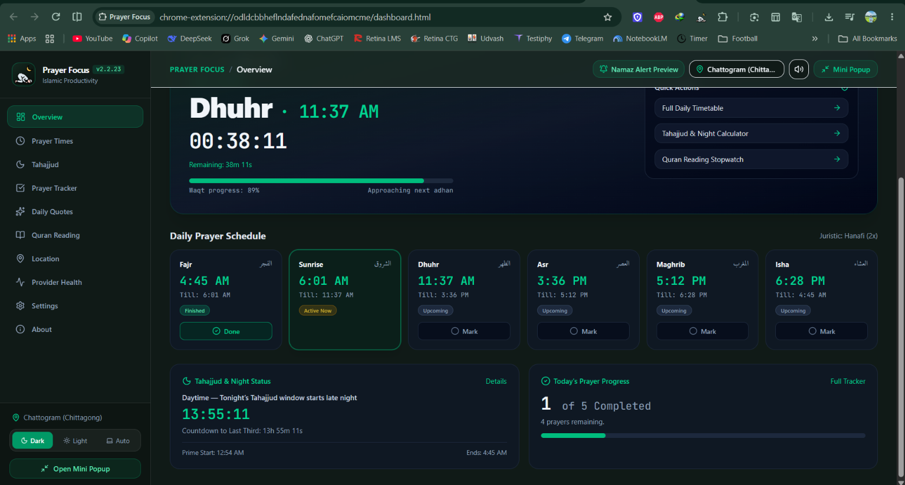
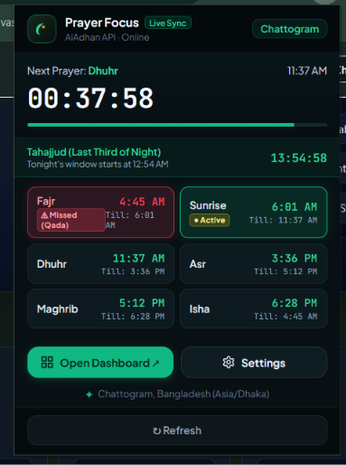

# 🌙 Prayer Focus `v2.2.23-Fixed`
### *All-in-One Modern Islamic Prayer Companion, Extension & Productivity Suite*

<div align="center">

[](#)
[](LICENSE)
[](https://react.dev/)
[](https://vitejs.dev/)
[](https://tailwindcss.com/)
[](#)

</div>

---

## 📸 Visual Showcase & Previews

<div align="center">

| 🖥️ Full Web & Extension Dashboard | 📱 Extension Action Popup Modal |
| :---: | :---: |
|  |  |
| *Full-featured desktop dashboard featuring live waqt countdowns, prayer cards with **`Till:`** limits, 5-Fard progress bar, and Tahajjud Last Third calculator.* | *Compact Manifest V3 Chrome Extension popup showing real-time ticking countdown, active/upcoming waqt windows, and auto **Missed (Qada)** badge in red.* |

</div>

---

## ✨ Highlights & Core Features

> [!TIP]
> **Prayer Focus** seamlessly combines astronomical solar precision with a clean, clutter-free user interface available both as a standalone Web App and a background Chrome Extension.

<table>
  <tr>
    <td width="50%" valign="top">
      <h3>🕌 1. Start-to-Till Waqt Windows</h3>
      <ul>
        <li><b>Standardized Timing</b>: Displays exact start and end times for all 5 daily Fard prayers + Sunrise using clean 12-hour AM/PM formatting with clear <code>Till:</code> prefixes (e.g. <i>Fajr 4:45 AM · Till: 6:01 AM</i>).</li>
        <li><b>Auto Qada Status Badge</b>: Automatically detects expired prayer windows and flags them with a distinct <b>Missed (Qada)</b> rose border and badge.</li>
        <li><b>5-Fard Obligation Focus</b>: Obligatory progress trackers strictly count the 5 obligatory prayers (Fajr, Dhuhr, Asr, Maghrib, Isha).</li>
      </ul>
    </td>
    <td width="50%" valign="top">
      <h3>🌌 2. Live Tahajjud & Night Calculator</h3>
      <ul>
        <li><b>Exact Astronomical Math</b>: Calculates total night duration from Maghrib sunset to next day's Fajr dawn.</li>
        <li><b>Last Third of Night Window</b>: Automatically pinpoints the exact start of the prime Tahajjud time (e.g. <i>12:54 AM</i>) with a live ticking countdown.</li>
        <li><b>Day/Night Mode Switching</b>: Provides real-time context whether it's daytime preparation or active night worship time.</li>
      </ul>
    </td>
  </tr>
  <tr>
    <td width="50%" valign="top">
      <h3>🔔 3. Continuous Adhan & Snooze Overlay</h3>
      <ul>
        <li><b>Looping Audio Chime</b>: Plays soothing Adhan chime when prayer window opens until explicitly acknowledged.</li>
        <li><b>Persistent In-App Modal</b>: High-priority overlay notification featuring curated Bengali Islamic quotes.</li>
        <li><b>10-Minute Snooze</b>: Click <i>Pray Later</i> to snooze reminders in 10-minute intervals until marked completed.</li>
      </ul>
    </td>
    <td width="50%" valign="top">
      <h3>📅 4. 30-Day Monthly Progress Matrix</h3>
      <ul>
        <li><b>5-Dot Daily Calendar</b>: Interactive 7-column calendar matrix tracking individual prayer completion per day.</li>
        <li><b>Timezone-Safe Storage</b>: Employs local <code>YYYY-MM-DD</code> ISO serialization preventing UTC date boundary shifts.</li>
        <li><b>Monthly Stats</b>: Displays total prayers completed, missed count, and overall compliance rate.</li>
      </ul>
    </td>
  </tr>
  <tr>
    <td width="50%" valign="top">
      <h3>📖 5. 60+ Bengali Quotes Library</h3>
      <ul>
        <li><b>Quran & Hadith References</b>: Curated Islamic reminders in clear Bengali translation.</li>
        <li><b>Bookmarking & Copying</b>: Save favorite quotes or copy text with one click.</li>
        <li><b>Hourly Inspiration</b>: Auto-rotates quote displays across dashboard views.</li>
      </ul>
    </td>
    <td width="50%" valign="top">
      <h3>⏱️ 6. Quran Recitation Stopwatch</h3>
      <ul>
        <li><b>Session Log</b>: Integrated timer to track daily Quran reading and study duration.</li>
        <li><b>Historical Records</b>: Stores daily recitation history and total minutes spent in Quran study.</li>
      </ul>
    </td>
  </tr>
</table>

---

## ⚙️ 5-Tier Resilient Prayer Timing Architecture

Prayer Focus uses a multi-layered cascading fallback system to guarantee 100% reliable timing calculations even offline:

```
┌────────────────────────────────────────────────────────────────────────┐
│  Tier 1: AlAdhan High-Precision Coordinates API (GPS / Lat-Long)       │
├────────────────────────────────────────────────────────────────────────┤
│  Tier 2: AlAdhan City & Country Regional Fallback                      │
├────────────────────────────────────────────────────────────────────────┤
│  Tier 3: PrayZone Global Prayer API                                    │
├────────────────────────────────────────────────────────────────────────┤
│  Tier 4: Islamic Network API Service                                   │
├────────────────────────────────────────────────────────────────────────┤
│  Tier 5: Local Solar Math Calculation Engine (100% Offline Capable)    │
└────────────────────────────────────────────────────────────────────────┘
```

> [!NOTE]
> If network connectivity drops or API servers experience downtime, Tier 5 automatically takes over using client-side solar zenith angle algorithms (supporting Hanafi and Shafi/Standard Asr juristic methods).

---

## 📐 Math & Astronomical Calculation Formulas

<details>
<summary><b>🔍 View Tahajjud & Waqt Progress Equations</b></summary>

<br/>

### 1. Tahajjud (Last Third of Night) Formula
$$\text{Night Duration} = T_{\text{Fajr (Tomorrow)}} - T_{\text{Maghrib (Today)}}$$

$$T_{\text{Tahajjud Start}} = T_{\text{Maghrib}} + \left( \frac{2}{3} \times \text{Night Duration} \right)$$

### 2. Waqt Progress Percentage Formula
$$P_{\text{Waqt}} = \min\left(100, \max\left(0, \frac{T_{\text{Current}} - T_{\text{Start}}}{T_{\text{End}} - T_{\text{Start}}} \times 100\right)\right)$$

</details>

---

## 🔌 Installation & Usage Guide

### Option A: Install Chrome Extension (Pre-built ZIP)

> [!IMPORTANT]
> The extension package `Prayer-Focus-v2.2.23-Fixed.zip` is located directly in the root of the project directory.

1. **Download / Extract**: Unpack `Prayer-Focus-v2.2.23-Fixed.zip` to a folder on your computer.
2. **Open Extensions**: Navigate to `chrome://extensions/` in Google Chrome or Microsoft Edge.
3. **Enable Developer Mode**: Turn on the **Developer mode** toggle in the top-right corner.
4. **Load Extension**: Click **Load unpacked** and select the extracted folder.
5. **Pin Extension**: Pin **Prayer Focus 🌙** to your browser toolbar for quick access.

---

### Option B: Local Web App Development

```bash
# 1. Clone repository
git clone https://github.com/user/prayer-focus.git
cd prayer-focus

# 2. Install dependencies
npm install

# 3. Launch Vite development server
npm run dev
```

> Access the live app at `http://localhost:3000`.

---

### Option C: Build Extension from Source

```bash
# Compile web assets and generate fresh extension package
npm run build && node scripts/pack-extension.js
```
*Output zip file is saved to `./Prayer-Focus-v2.2.23-Fixed.zip`.*

---

## 📁 Project Structure

```
├── Prayer-Focus-v2.2.23-Fixed.zip # Distribution Chrome Extension Package
├── dist/                          # Production Web Build Output
├── extension/                     # Manifest V3 Chrome Extension Source
│   ├── manifest.json              # MV3 Configuration & Permissions
│   ├── popup.html                 # Extension Popup Entry View
│   ├── popup.css                  # Extension Popup Styles
│   ├── popup.js                   # Extension Storage Sync & Ticking Timer
│   ├── content.js                 # In-Page Notification Injector
│   └── background.js              # Service Worker & Alarm Manager
├── public/                        # Static Assets & Screenshots
│   └── assets/aistudio/           # Preview Screenshots (e957b2c9.png, 5bcbae04.png)
├── scripts/
│   └── pack-extension.js          # ZIP Packaging Script
├── src/
│   ├── components/                # React UI Components
│   │   ├── views/                 # Core Dashboard Views (Overview, PrayerTimes, etc.)
│   │   ├── modals/                # CalendarModal, PrayerReminderModal, etc.
│   │   └── MiniWidget.tsx         # In-Dashboard Interactive Extension Popup View
│   ├── data/                      # Bengali Quotes Library & City Presets
│   ├── services/                  # PrayerService, Solar Math & Storage Controllers
│   ├── types/                     # TypeScript Interfaces
│   ├── utils/                     # Tahajjud & Date Formatting Utilities
│   ├── App.tsx                    # Primary Application Shell
│   └── main.tsx                   # React Vite Entry Point
├── package.json                   # NPM Configuration & Dependencies
├── tsconfig.json                  # TypeScript Compiler Config
└── vite.config.ts                 # Vite Build Configuration
```

---

##  Author & Developer

<div align="center">


### Designed & Developed by **Tausif Rahaman Raiyan**

[](https://tausif-rahaman-raiyan.github.io/)
[](https://www.instagram.com/tausifrahamanraiyan/)

</div>

> *"Tausif Rahaman Raiyan, a university admission candidate with a deep passion for web development, technology, and problem-solving. I enjoy transforming creative ideas into practical projects, exploring new technologies, and building digital experiences that are both meaningful and useful. For me, programming is more than just writing code; it is a way to think creatively, overcome challenges, and turn imagination into reality."*

---

## 📜 License

Distributed under the **Apache-2.0 License**. See `LICENSE` for more information.
